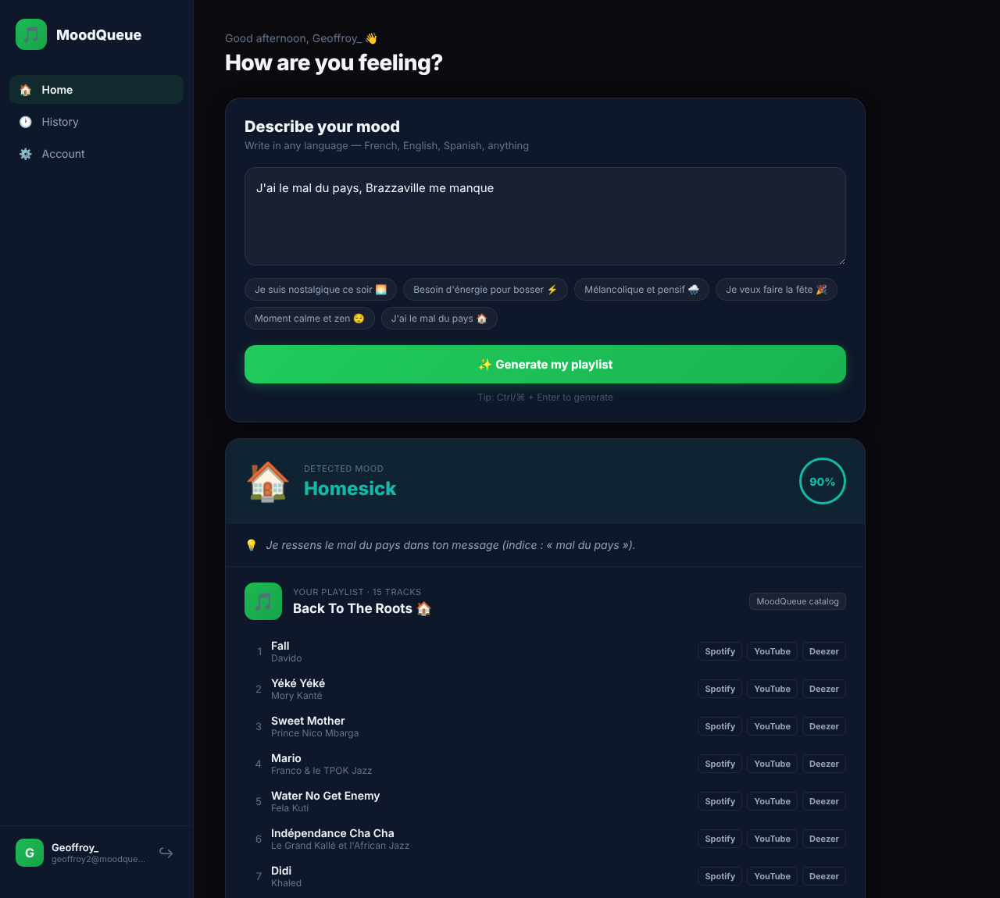
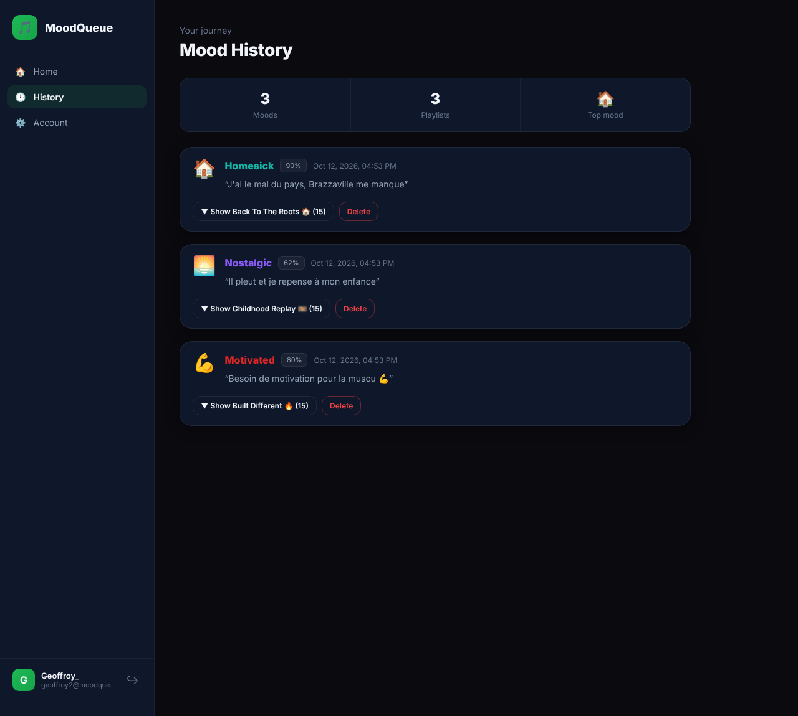
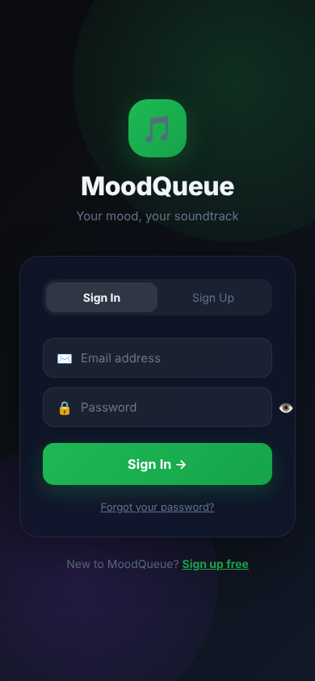

# 🎵 MoodQueue

**Describe how you feel, in any language — get a playlist that matches.**

MoodQueue is a full-stack app (FastAPI + React + React Native) that analyzes free-form text to detect a mood and its context, then builds a personalized playlist. It uses AI (Groq / gpt-oss-20b) and Spotify when they are available, and **keeps working without them**: an offline mood engine and a built-in music catalog take over automatically.

🌐 **Live demo: [moodqueue.onrender.com](https://moodqueue.onrender.com)** — hosted for free on Render + Neon, the first visit can take ~1 min while the server wakes up.

> Anyone can create an account, get an **AI mood analysis** (Groq · gpt-oss-20b) and a playlist (built-in catalog with Spotify / YouTube / Deezer links). **Saving playlists directly to a Spotify account** is limited to invited users because of Spotify's API rules — see the *Spotify limitations* section below.



<p align="center"> </p>

---

## ⚡ Quick start (one command)

Requires only [Docker](https://www.docker.com/).

```bash
git clone https://github.com/GeoJun77/MoodQueue.git
cd moodqueue
docker compose up -d
```

Open **http://localhost:8000**, create an account, describe your mood. That's it: no API key, no database to install, no account anywhere.

To enable the optional services (AI, Spotify, emails), copy `.env.example` to `.env`, fill in what you want, and run `docker compose up -d` again.

---

## 🧠 How it works

```
 "Je suis nostalgique ce soir"
            │
            ▼
 ┌──────────────────────┐   GROQ_API_KEY set and API up?
 │   Mood analysis      │── yes ─▶ Groq gpt-oss-20b: mood, context, search queries (30+ contexts)
 │                      │── no ──▶ Offline engine: multilingual keyword classifier (FR/EN/ES/PT)
 └──────────┬───────────┘
            │  mood · confidence · explanation · artists/genres mentioned
            ▼
 ┌──────────────────────┐   Spotify configured and account connected?
 │   Playlist builder   │── yes ─▶ Real Spotify playlist, 3-layer search:
 │                      │          1. artists you named  2. genres you named  3. mood queries
 │                      │── no ──▶ Built-in catalog: 16 moods × 12 tracks,
 └──────────────────────┘          with Spotify / YouTube / Deezer links for every track
```

Every external call has a timeout and a fallback, so an expired key, a changed API or a dead service never breaks the app — it just gets a bit less smart.

| Feature | With the service | Without it |
|---|---|---|
| Mood analysis | Groq gpt-oss-20b (nuanced, 30+ contexts) | Offline engine (keywords, 4 languages) |
| Playlist | Saved in your Spotify account | Built-in catalog + links to Spotify, YouTube, Deezer |
| Password reset | Email via Resend | Reset link printed in the server logs |
| Database | PostgreSQL | SQLite file (`backend/data/moodqueue.db`) |

---

## ✨ Features

- Sign up / log in (JWT), forgot & reset password, delete account
- Multilingual mood analysis (any language with AI; FR/EN/ES/PT offline)
- Detection of explicitly mentioned artists and genres
- 16 moods: happy, sad, angry, calm, energetic, nostalgic, romantic, focused, anxious, melancholic, spiritual, party, motivated, lonely, hopeful, homesick
- Playlist with every track listed and playable on Spotify, YouTube or Deezer
- Optional Spotify account linking (secure, signed OAuth state)
- History of moods and playlists, with delete
- Responsive web app (desktop sidebar, mobile tab bar)
- iOS / Android app (Expo)
- One Docker image = web app + API + database
- Automatic database migrations at startup (Alembic)
- 38 automated tests, CI on GitHub Actions (tests, web build, Docker build + smoke test, monthly run)

---

## 🏗️ Tech stack

| Layer | Technology |
|---|---|
| Backend | Python 3.12, FastAPI, SQLAlchemy 2 (async), Alembic |
| Database | SQLite (default) or PostgreSQL |
| AI (optional) | Groq — OpenAI gpt-oss-20b (model configurable with `GROQ_MODEL`) |
| Music (optional) | Spotify Web API (OAuth2) |
| Email (optional) | Resend |
| Auth | JWT (PyJWT) + bcrypt |
| Web | React 19 + Vite, served by the backend |
| Mobile | React Native (Expo) |
| Ops | Docker, Docker Compose, GitHub Actions |

---

## 💻 Local development (without Docker)

**Backend** (Python 3.12):

```bash
cd backend
python -m venv .venv
.venv\Scripts\activate            # Windows  (macOS/Linux: source .venv/bin/activate)
pip install -r requirements-dev.txt
uvicorn app.main:app --reload     # http://127.0.0.1:8000  — API docs at /docs
```

**Web** (Node 20+), in another terminal:

```bash
cd web
npm install
npm run dev                       # http://localhost:5173 (API calls are proxied to :8000)
```

**Tests:**

```bash
cd backend && python -m pytest -q
```

**Mobile app** (Expo): copy `frontend/.env.example` to `frontend/.env`, set your computer's local IP, then `cd frontend && npm install && npx expo start` and scan the QR code with Expo Go.

---

## ⚙️ Configuration

Everything is optional. See [`.env.example`](.env.example) for the full list.

| Variable | Purpose | Default |
|---|---|---|
| `DATABASE_URL` | PostgreSQL URL (Railway/Heroku format accepted) | SQLite in `DATA_DIR` |
| `SECRET_KEY` | JWT signing key | generated once, stored in `DATA_DIR` |
| `GROQ_API_KEY` | AI analysis ([console.groq.com](https://console.groq.com)) | offline engine |
| `SPOTIFY_CLIENT_ID` / `SPOTIFY_CLIENT_SECRET` / `SPOTIFY_REDIRECT_URI` | Spotify playlists | built-in catalog |
| `RESEND_API_KEY` / `EMAIL_FROM` | Password reset emails | link in logs |
| `FRONTEND_URL` | Web app URL if hosted separately (e.g. Vercel) | same origin |
| `FRONTEND_ORIGINS` | Extra CORS origins | — |

The old `OPENAI_API_KEY` variable (holding a Groq `gsk_...` key) still works.

**Spotify setup:** create an app on the [Spotify dashboard](https://developer.spotify.com/dashboard), add the redirect URI `http://127.0.0.1:8000/api/playlist/callback` (or your public URL + `/api/playlist/callback`). In development mode Spotify only allows users you add manually in the dashboard (max 5) — everyone else automatically gets the built-in catalog.

---

## ☁️ Deployment

**Free & recommended: Render + Neon.** Create a free Postgres on [neon.com](https://neon.com) and copy its connection string (`?sslmode=require` URLs are supported). On [render.com](https://render.com): *New → Blueprint →* this repo. `render.yaml` creates the service; paste the Neon URL into `DATABASE_URL` and leave the optional keys empty if you don't need them. The app is then live at `https://<name>.onrender.com` (the free instance sleeps after 15 min idle; the first visit takes ~1 min to wake it).

**Any other host: one service.** Deploy the root `Dockerfile` on any container host (Railway, Render, Fly.io, a VPS…). It serves the web app and the API on the same URL and reads `$PORT`. Mount a volume on `/app/data` to keep the SQLite database, or set `DATABASE_URL` to a PostgreSQL database.

**Split setup (original):** API from `backend/` (its own `Dockerfile`, or `Procfile`) on Railway, web app from `web/` on Vercel with `VITE_API_URL=https://<your-api>`. Then set `FRONTEND_URL=https://<your-vercel-app>` on the API so reset links and the Spotify redirect point to the web app.

Migrations run automatically at startup, so no pre-deploy command is needed (running `alembic upgrade head` beforehand is harmless).

**Current production setup**

| Part | Service | Notes |
|---|---|---|
| Web app + API | [Render](https://render.com) (free web service, Docker) | `render.yaml`, auto-deploy on every push to `main` |
| Database | [Neon](https://neon.com) (free Postgres) | direct connection string (pooling off), `?sslmode=require` supported |
| AI | [Groq](https://console.groq.com) (free API key) | model `openai/gpt-oss-20b`, set with `GROQ_API_KEY` |
| Spotify | Spotify for Developers app (owner with Premium) | redirect URI `https://moodqueue.onrender.com/api/playlist/callback` |
| Email | — (not configured) | reset links are written to the Render logs |

Check what is enabled at any time: [`/api/status`](https://moodqueue.onrender.com/api/status).

**Enabling Spotify on a deployment**

1. On [developer.spotify.com/dashboard](https://developer.spotify.com/dashboard), create an app with the **Web API** and the redirect URI `https://<your-app>/api/playlist/callback`.
2. In *User Management*, add the Spotify email of every person who will connect their account.
3. On the host (Render → *Environment*), set `SPOTIFY_CLIENT_ID`, `SPOTIFY_CLIENT_SECRET` and `SPOTIFY_REDIRECT_URI` (same URL as step 1), then redeploy.
4. `GET /api/status` should now return `"spotify": true`.

---

## ⚠️ Spotify limitations

Spotify restricts apps that are not run by a registered organization:

- The app stays in **development mode**: at most **5 Spotify users**, each added manually in the dashboard (*User Management*).
- The **owner of the Spotify developer app must have Spotify Premium**, otherwise the Web API is blocked for the whole app.
- Extended quota (public access) is only granted to organizations.

That's why MoodQueue never depends on Spotify: without a linked account, every analysis still returns a full playlist from the built-in catalog, with links to open each track on Spotify, YouTube or Deezer.

Want to try the Spotify integration on the live demo? Contact me with the email of your Spotify account: 📧 gankouedzongeoffroyjunior@gmail.com

---

## 🕰️ Bringing it back in 5, 10 or 20 years

The project is built to survive its dependencies:

1. **No external service is required.** If Groq, Spotify or Resend disappear, the app falls back to its offline engine, catalog and log-based reset links.
2. **Pinned versions everywhere:** Python packages (`requirements.txt`), npm packages (`package-lock.json`), Docker base images (exact tags).
3. **A full offline backup:** run `scripts/make-archive.sh` (or `scripts\make-archive.ps1` on Windows). It saves the complete Docker image (with every dependency already installed) and the source code into `archive/<date>/`. Keep that folder on an external drive and in the cloud.
4. **To restore**, follow `RESTORE.txt` in the archive:
   ```bash
   docker load -i moodqueue-image.tar.gz
   docker run -p 8000:8000 moodqueue:<date>
   ```
5. **The CI runs every month**, so if a dependency breaks you'll know long before you need the app.

If even Docker is gone, the backend is plain Python: install Python 3.12 and `pip install -r backend/requirements.txt`, and the web app is static files in `web/dist`.

---

## 📁 Project structure

```
moodqueue/
├── Dockerfile                 # all-in-one image (web + API)
├── docker-compose.yml         # docker compose up -d
├── .env.example               # optional configuration
├── backend/
│   ├── app/
│   │   ├── api/routes/        # auth.py, mood.py, playlist.py
│   │   ├── core/              # config, database, security, dependencies
│   │   ├── models/            # User, MoodEntry, Playlist
│   │   ├── schemas/           # request/response models
│   │   └── services/
│   │       ├── mood_service.py     # Groq analysis + automatic fallback
│   │       ├── local_mood.py       # offline multilingual mood engine
│   │       ├── catalog.py          # built-in music catalog (16 moods)
│   │       ├── music_service.py    # Spotify or catalog playlist builder
│   │       ├── spotify_service.py  # Spotify API (OAuth, search, playlists)
│   │       └── email_service.py    # Resend emails or log fallback
│   ├── alembic/               # database migrations (run at startup)
│   ├── tests/                 # pytest suite
│   └── Dockerfile             # API-only image
├── web/                       # React + Vite web app
├── frontend/                  # React Native (Expo) mobile app
├── scripts/                   # make-archive.sh / .ps1
└── .github/workflows/ci.yml
```

## 🔌 API

Interactive documentation at **`/docs`** when the server runs.

| Method | Endpoint | Description |
|---|---|---|
| GET | `/api/status` | Enabled optional features |
| POST | `/api/auth/register` | Create an account |
| POST | `/api/auth/login` | Log in |
| GET / DELETE | `/api/auth/me` | Profile / delete account |
| POST | `/api/auth/forgot-password` | Send a reset link |
| POST | `/api/auth/reset-password` | Set a new password |
| POST | `/api/mood/analyze` | Analyze mood + build playlist |
| GET | `/api/mood/history` | Moods with their playlists |
| DELETE | `/api/mood/history/{id}` | Delete a mood |
| GET | `/api/playlist/connect` | Spotify login URL |
| GET | `/api/playlist/callback` | Spotify OAuth callback |
| POST | `/api/playlist/disconnect` | Unlink Spotify |
| GET | `/api/playlist/history` | Playlists |

---

## 👤 Author

**Geoffroy GANKOUE** — Full-stack project, Master's in Data & Artificial Intelligence (ESILV).

Licensed under the [MIT License](LICENSE).
